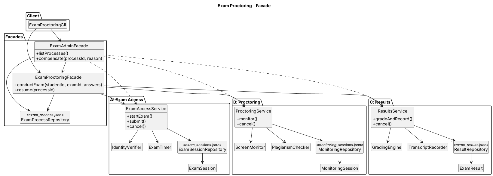

# Assignment 4: Exam Proctoring

The program runs an exam through three subsystems: **A**, then **B**, then **C**. The client makes a
single facade call, `examFacade.conductExam(studentId, examId, answers)`, and the facade does the rest.

| Step | Subsystem | What it does | Failure |
|------|-----------|--------------|---------|
| A | Exam Access | checks the student ID and starts the exam session | invalid student ID, so nothing is saved |
| B | Proctoring | turns on screen monitoring and checks the answers for plagiarism | screen monitor is offline, so A is cancelled |
| C | Results | grades the work and writes the letter grade | grading engine rejects the work, so B is voided and then A is cancelled |

All data is saved as JSON files in the `data/` folder.

## How to run

You need JDK 17+ and Maven.

```bash
mvn -q compile exec:java
```

Menu:

```text
1. Start normal exam
2. Simulate Screen Monitor failure
3. Simulate Grading Engine failure
4. View persisted state
5. Resume interrupted exam
6. Manual compensation
7. Exit
```

The enrolled students are `230001`, `230002` and `230003`. The exams are `SDP-FINAL` and `OOP-MIDTERM`.
If you leave the answers empty, the correct answers are used.

**Reset the data:** delete the `data/` folder before you start the program.

**Restart demo:**

1. Choose 5. When there are no unfinished exams, the program offers to start one that stops after step A.
2. Exit with 7 and run the program again. On startup it shows the unfinished exam it found on disk.
3. Choose 5 to finish that exam.

## Tests

```bash
mvn verify
```

This runs 30 JUnit 5 tests. The JaCoCo coverage report is written to `target/site/jacoco/index.html`,
and a copy is kept in `docs/coverage/`. Line coverage is 99%, and the build fails if it drops below 80%.

Every test gets its own empty `@TempDir`, so the tests do not depend on each other.

`ExamScenario` and `SavedProcess` are small helpers that make a test read like a sentence:

```java
ExamOutcome outcome = exam.gradingEngineIsDown().studentTakesExam(ALICE, SDP_FINAL);

exam.onDisk(outcome).stageIs(COMPENSATED)
        .resultIs(REJECTED).monitoringIs(VOIDED).sessionIs(CANCELLED)
        .rolledBack("B", "A");
```

`onDisk` reads the JSON files again with new repositories, so a test checks what was really saved.

## Architecture



- `access`, `monitoring`, `results` are the three subsystems. Each one has a service, business logic classes,
  an entity with its own statuses, and a repository that writes its own JSON file. The subsystems do not
  import each other. B and C only keep A's session ID as a string.
- `facade` contains the two facades:
  - `ExamProctoringFacade` runs A → B → C and rolls back on failure.
  - `ExamAdminFacade` shows the saved state and can roll back an exam by hand.
- `app` contains the CLI and `ProctoringSystem`, which creates all objects.

The progress of each exam is saved in `exam_process.json` with a stage: `PENDING_B`, `PENDING_C`,
`COMPLETED` or `COMPENSATED`. After every step the facade saves the new stage, reads it back from the file,
and chooses the next step from it. Because of this, the same code works for a new exam and for an exam
continued after a restart. Rollback undoes C, then B, then A. It only undoes steps whose IDs are saved in the
process, and it writes each undo step to `rollbackLog`.

## Principle of Least Knowledge

Before, without a facade, the client has to know every subsystem and every rollback rule:

```java
ExamSession session = access.startExam(studentId, examId);
MonitoringSession monitoring;
try {
    monitoring = proctoring.monitor(session.getId(), studentId, answers);
} catch (ScreenMonitorUnavailableException e) {
    access.cancel(session.getId());
    throw e;
}
try {
    ExamResult result = results.gradeAndRecord(session.getId(), studentId, examId, answers);
    access.submit(session.getId());
    System.out.println(result.getScore() + " " + result.getGrade());
} catch (GradingRejectedException e) {
    proctoring.cancel(monitoring.getId());
    access.cancel(session.getId());
    throw e;
}
```

After, the client talks to one facade and gets one result back:

```java
ExamOutcome outcome = examFacade.conductExam(studentId, examId, answers);
System.out.println(outcome);
```

## Why Facade and not Adapter

An Adapter changes the interface of one existing class so it fits the interface a client already expects.
Here nothing has a wrong interface: `ExamAccessService`, `ProctoringService` and `ResultsService` are
already easy to use on their own. The real problem is that one action, "take an exam", needs all three in a
fixed order, and if B or C fails the earlier steps must be undone. A Facade solves exactly this. It gives the
client one simple method, `conductExam`, and keeps the order of steps, the saved progress and the rollback
inside. The subsystems stay independent and can still be used directly.
